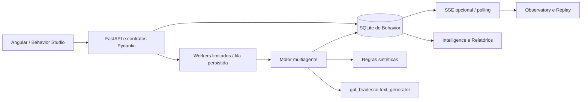

# Behavior 3.0 — Studio · Observatory · Intelligence

**Data:** 2026-11-12  
**Estado:** desenvolvimento funcional; requer homologação integrada (Angular + Bridge corporativa)  
**Responsável pelo aceite:** equipe proprietária, a definir  
**Escopo:** agentes e organizações **fictícios**, ambientes hipotéticos, saídas estruturadas, comparação de experimentos, replay e análise descritiva. A nova versão preserva os módulos BJN, Auditoria e AI Ready.

## 1. O que fazer em cada área

| Área | Objetivo | Entrada | Resultado |
|---|---|---|---|
| **Studio · Criar** | Começar com descrição livre ou exemplo, sem programar | Texto do cenário, quantidade de perfis (2–10) | Agentes, mundo e sociedade editáveis, mediante Bridge configurada |
| **Agentes** | Definir personas fictícias | Editor de perfis, modelos ou CSV | Registros por perfil e colunas dinâmicas |
| **Cenários** | Descrever contexto, variáveis, eventos e resultados desejados | Ambiente, sociedade, métricas e ações permitidas | Contratos versionados, comparáveis e auditáveis |
| **Observatory** | Controlar e observar rodadas | Rodadas, repetições, modo, seed e parâmetros | Rede SVG, timeline, conversa dirigida, inspeção e replay |
| **Resultados** | Analisar uma execução | Histórico e resultados armazenados | Médias sintéticas, métricas customizadas, calibração agregada e relatório |
| **Intelligence** | Comparar hipóteses | Base, variantes e análise de sensibilidade | Execuções separadas, diferenças sintéticas, acesso aos detalhes |

### Fluxo mínimo sem IA

1. Configure `.env` apenas em ambiente local de desenvolvimento com a demonstração habilitada, seguindo `README.md`.
2. Na página Behavior, crie um **cenário fictício** de mercado, organização ou mobilidade.
3. Revise os seis agentes gerados; use **Agentes** para incluir/excluir atributos ou importar tabela CSV.
4. Em **Cenários**, revise eventos, crie métricas (numérica, booleana e categórica) e, se desejar, autorize variáveis do mundo que agentes podem alterar. Salve.
5. Abra **Observatory**: selecione ambiente e sociedade; escolha modo **Demonstração**, duas rodadas, três repetições, uma seed explícita e parâmetros desejados.
6. Execute, selecione uma rodada e clique nas conexões, conversas e nós. As mensagens do lado direito são fatos registrados no simulador, não a transcrição de uma conversa humana real.
7. Em **Intelligence**, escolha base e alternativa A (ex.: incerteza 0,25 em vez de 0,50) ou execute a grade de sensibilidade; examine as diferenças e inspecione runs individuais.
8. Em **Resultados**, exporte JSON/CSV/Markdown e, se houver referência agregada aprovada, registre a comparação com essa média. **Não envie microdados ou nomes reais**.

### Exemplos de indicadores

Em **Cenários**, defina os resultados desejados sem mudar o código:

- `valor_proposta`, número entre 0 e 1000, descrição “valor sintético negociado”.
- `acordo`, booleano, descrição “houve acordo no cenário”.
- `estrategia`, categoria com opções “cooperar”, “negociar” e “recusar”.

No modo IA, o prompt pede que `text_generator` forneça `Reaction.metrics` tipado; uma métrica sem evidência pode permanecer `null` e será **excluída** de agregações numéricas. Tipo e faixas são validados no backend, e uma resposta inválida encerra a execução com erro identificável. No modo demo, métricas são mapeamentos **ilustrativos** da pontuação de estado (`stance`), e **não** simulações economicamente calibradas. A escala `stance` 0–100 continua existindo para compatibilidade com cenários anteriores e influência coletiva.

### Ações que alteram o mundo

A opção **Habilitar mudanças de ambiente produzidas por agentes** vem desativada. Só é possível registrar alterações de variáveis previamente cadastradas e valores explicitamente autorizados. A ação é aplicada no **fim da rodada**, aparece como `AGENT_ACTION` e influencia somente rodadas posteriores. Ações jamais enviam comandos a sistemas externos. Conflitos entre agentes na mesma rodada são resolvidos pela ordem estável de processamento (última proposta válida); a sequência de eventos documenta as mudanças.

## 2. Parâmetros e limites

| Parâmetro | Padrão / restrição | Interpretação |
|---|---|---|
| `mode` | `demo` local, `bridge` corporativo | Regras ilustrativas ou IA |
| `rounds` | 3 / 1 a 6 | Passos de evolução |
| `repetitions` | 1 / 1 a 10 | Reinícios independentes |
| `seed` | 42 / inteiro não negativo | Controla aleatoriedade no demo |
| `temperature` | 0,2 / 0 a 2 | Solicitada ao modelo IA (sujeita ao provedor) |
| `uncertainty` | 0,2 / 0 a 1 | Variação estocástica |
| `social_pressure` | 0,55 / 0 a 1 | Influência de pares |
| `shock_probability` | 0,15 / 0 a 1 | Sorteio de choque por rodada |
| `shock_intensity` | 0,35 / 0 a 1 | Magnitude sintética |
| `network_density` | 0,45 / 0 a 1 | Probabilidade de ligação entre pares |
| `memory_window` | 4 / 1 a 10 | Número de elementos recentes no contexto próprio do agente |
| `max_tokens_per_reaction` | 420 / 128 a 1.200 | Limite de saída solicitado à Bridge |
| `environment.metrics` | Até 12 | Métricas customizadas validadas |
| `environment.events` | Até 12 | Mudanças programadas |
| `environment.allowed_agent_effects` | Até 8 variáveis, 8 valores por variável | Efeitos seguros, exclusivamente fictícios |

Uma chamada IA é planejada por agente/rodada/repetição. Portanto: 6 agentes × 3 rodadas × 3 repetições = **54 chamadas planejadas**, não consumo medido. A configuração `BEHAVIORAL_LAB_MAX_CALLS` determina o limite por run (padrão **120**). Em comparações, a soma é limitada a três vezes esse parâmetro e cada run mantém seu próprio limite. Uma variante por vez é processada pelo orquestrador; o pool compartilha até **dois workers** com execuções convencionais. A fila admite até **40 runs pendentes ou ativos**; execuções ainda não iniciadas são recuperáveis após reinício. As que estavam rodando são marcadas como `INTERRUPTED` e exigem ação humana para evitar repetir chamadas cobradas.

`Intelligence` oferece até **6 variantes** além do cenário-base. Mantém perfis e seed e altera somente parâmetros explicitamente informados. A rede inicial permanece comparável quando densidade de rede não muda. Para variáveis do mundo no modo **demo**, defina `impact` em −1 a +1 como suposição de efeito; **nomes ou valores textuais não produzem efeitos causais deduzidos automaticamente**. No modo `bridge`, variáveis atualizadas entram no prompt e o efeito é dependente do LLM.

## 3. Arquitetura



| Componente | Responsabilidade | Entrada → saída |
|---|---|---|
| `applications/behavior/backend/contracts.py` | Tipos, limites e validação semântica | HTTP JSON → modelos Pydantic |
| `applications/behavior/backend/router.py` | Autorização de modos, endpoints, custo máximo e exportações | Requisição → resposta HTTP |
| `applications/behavior/backend/repository.py` | Transações, snapshots, eventos, revisões, calibrações, filas | Objeto válido → SQLite |
| `applications/behavior/backend/simulator.py` | Redes, choques, reações, memória curta, ações permitidas e agregação | Snapshot → eventos e resultado |
| `applications/behavior/backend/experiments.py` | Comparação A/B sequencial com checkpoints de variantes | Plano → runs comparáveis |
| `backend/services/bradesco_bridge.py` e `gpt_bradesco.py` da raiz | Fachada e módulo corporativo únicos para todas as aplicações | Prompt → resultado de IA |
| `prompts/behavioral_lab/reaction.system.md` | Contrato de reação, métricas e fronteira de confiança | Contexto fictício → JSON da reação |
| `frontend/src/app/behavioral-lab/*` | UI tipada, observatório e análise de experimentos | API → visualização |
| `frontend/src/behavioral-lab.scss` | Tema vermelho/grafite, três painéis, responsividade | Design → estilos |

### Fluxo do worker

1. `POST /simulacoes` valida contexto, sociedade, modo e orçamento; `LabRepository.create_run` salva a configuração e o snapshot imutável com status `QUEUED`.
2. `LabSimulator.execute` carrega os dados, verifica cancelamento, inicia `RUNNING` e define a semente local para cada repetição.
3. Para cada rodada, aplica eventos programados, registra `ENVIRONMENT_SNAPSHOT`, sorteia choque e, para cada agente, lê memória compacta, contexto e reações de pares da rodada anterior. Invoca `_demo_reaction` ou `_bridge_reaction`, valida métricas e registra `REACTION`.
4. Mensagens dirigidas geram `CONVERSATION`, cuja memória será entregue na **próxima rodada**. O evento `INTERACTION` marca o uso de falas da rodada anterior; os dois não são diálogos síncronos.
5. Propostas `environment_updates` são validadas contra a allowlist e aplicadas após o encerramento da rodada; ficam registradas como `AGENT_ACTION`.
6. `ROUND_SUMMARY` e `REPETITION_COMPLETED` marcam checkpoints; `consolidate` calcula médias sintéticas e métricas definidas pelo cenário, sem estimar intervalos de confiança para o mundo real.
7. O observatório lê `/simulacoes/{id}`, pode usar `/stream` (SSE, opcional), seleciona repetição/rodada e destaca mensagens, conexões e alterações do mundo. O frontend atual usa **polling como mecanismo padrão**; SSE está disponível para integração posterior.

### Endpoints adicionados (base `/api/v3/laboratorio-comportamental`)

| Método | Caminho | Uso |
|---|---|---|
| POST | `/experimentos` | Enviar A/B/sensibilidade, incluindo snapshot e orçamento |
| GET | `/experimentos` | Listar experimentos |
| GET | `/experimentos/{id}` | Consultar status e resultados por variante |
| GET | `/versoes/{kind}/{item_id}` | Histórico e hash de perfis, ambientes e sociedades |
| GET | `/simulacoes/{id}/stream` | Eventos incrementais SSE |
| GET | `/simulacoes/{id}/drift?threshold=10` | Comparação operacional com run anterior do mesmo ambiente |
| POST | `/simulacoes/{id}/calibracoes` | Registrar referência de média agregada aprovada |
| GET | `/simulacoes/{id}/calibracoes` | Listar referências registradas |
| GET | `/simulacoes/{id}/relatorio` | Relatório Markdown com resultados e rastreabilidade |

Os endpoints legados de agentes, cenários, sociedade e simulações permanecem disponíveis; o namespace antigo da API foi preservado por compatibilidade.

### Exemplo de envio A/B (IDs são fictícios)

```json
{
  "name": "Comparação ilustrativa",
  "hypothesis": "A incerteza modificará as reações sintéticas.",
  "baseline": {
    "environment_id": "ID_AMBIENTE_FICTICIO",
    "society_id": "ID_SOCIEDADE_FICTICIA",
    "mode": "demo",
    "rounds": 2,
    "repetitions": 3,
    "seed": 42
  },
  "variants": [
    {"name": "Incerteza baixa", "parameter_updates": {"uncertainty": 0.1}},
    {"name": "Incerteza alta", "parameter_updates": {"uncertainty": 0.8}}
  ]
}
```

## 4. Decisões e trade-offs

- **ADR-010 (2026-11-12): métricas flexíveis + estado legado.** Permitir booleanos, categorias e números por ambiente, mantendo `stance` 0–100 como estado de influência para não quebrar simulações anteriores. O motor ainda não suporta equações causais gerais entre métricas; o modo demo é explicitamente didático.
- **ADR-011: memória compacta.** Guardar até `memory_window` entradas narrativas recentes, sem raciocínio interno ou histórico ilimitado. Reduz custo e exposição do contexto; memória não é garantia de coerência.
- **ADR-012: efeitos de ações só por allowlist.** Ações sintéticas podem mudar variáveis locais, mas não executar operações bancárias, jurídicas ou externas. Rejeições são explícitas.
- **ADR-013: variantes comparáveis.** Mesmos perfis/seeds e snapshots congelados; comparação somente descritiva. Alterar densidade muda a rede; alterar temperatura remota não garante repetição idêntica.
- **ADR-014: fila SQLite com workers locais.** Simples e compatível com protótipo. Recupera pendentes após reinício, interrompe ativas; implantação multi-instância exige liderança/lease, fila distribuída e política de idempotência antes de produção.
- **ADR-015: versionamento de cadastros e runs.** Revisões append-only com SHA256, snapshots imutáveis e hash de prompt. Hash assegura rastreabilidade de conteúdo, não autenticidade de terceiros.
- **ADR-016: análise prudente.** Referência externa aceita **somente média agregada**; MAE/erro absoluto isolado não valida representatividade. Alerta `drift` é regra operacional parametrizada, não detector estatístico de distribuição real.
- **ADR-017: UI sem bibliotecas gráficas externas.** Rede SVG e timeline preservam identidade e reduzem superfície de dependências; desempenho e acessibilidade precisam de inspeção no browser corporativo.

## 5. Segurança e limites de uso

- Não informar dados de produção, clientes reais, credenciais ou informações protegidas no editor ou na criação assistida. Testes usam apenas dados fictícios.
- Dados enviados à Bridge entram no bloco `simulation_data_untrusted` sob instruções imutáveis; validação de JSON, tipos, categorias e allowlist ocorre após a resposta. Isso reduz riscos, mas **não elimina prompt injection**.
- Restrinja acesso, políticas de retenção, backup, políticas de logs e configuração de rede antes da homologação. O protótipo herda os controles da API base; não cria permissões individuais para cada sociedade.
- Verificar LGPD, finalidade, necessidade, documentação do tratamento, grupos protegidos, fairness e regras bancárias com Jurídico, Compliance, DPO e Segurança antes de qualquer integração com dados autorizados.
- A simulação **não mede** acurácia preditiva, taxa de atendimento real, efeitos causais, viés real nem economias de custo. Os exemplos e métricas demo são derivados de regras sintéticas.

## 6. Testes e homologação

- `python -m pytest -q` — backend e regressão dos módulos (incluindo Behavior).
- `cd frontend && npm test` — verificações de sintaxe, CSS e regressão textual. **Não substituem compilação Angular.**
- `cd frontend && npm run build` — obrigatória no ambiente que possui dependências Angular 21 homologadas.
- Executar manualmente: importação CSV, cadastro e cópia de agentes, cenário com três métricas, ações permitidas, execução demo com replay, comparação A/B com duas variantes, interrupção da fila, importação de resultados, calibração agregada, download Markdown, responsividade e navegação dos demais aplicativos.
- Homologar Bridge real com perfis estritamente fictícios e deployment autorizado; registrar versão efetiva do modelo, tokens cobrados quando disponíveis e consistência dos JSONs sob diferentes temperaturas.

**Pendências para implantação multiusuário:** fila transacional distribuída, RBAC por workspace e isolamento de execução, rate-limit por usuário, métricas reais de tokens e custo, monitoramento de qualidade do modelo, revisão de segurança das saídas, calibração externa e aceites de Compliance/Jurídico/DPO conforme o caso. Não apresentar o protótipo como plataforma científica validada sem esse trabalho.
