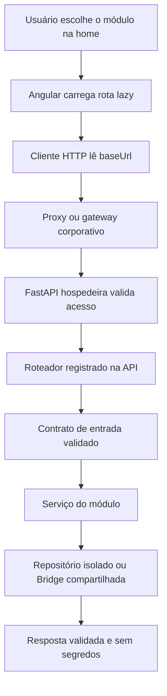

# Tutorial: criar e acoplar aplicações ao Ecossistema Jurídico

**Referência:** integração de 16/11/2026. O exemplo abaixo cria a aplicação **Triagem** sem alterar a lógica do BJN, da Auditoria, do Chatbot ou do Behavior. Todos os exemplos utilizam conteúdo fictício.

## 1. Conhecer a arquitetura

```text
ecossistema-juridico/
├── .env.example                        modelo único de ambiente
├── .env                                criar localmente; nunca versionar
├── gpt_bradesco.py                     única implementação corporativa
├── backend/
│   ├── principal.py                    FastAPI hospedeira, segurança e /api/v3
│   ├── central_environment.py          leitura única de configuração
│   └── services/bradesco_bridge.py     fachada da Bridge da API principal
├── applications/
│   ├── registry.py                     cadastro de módulos e subaplicações
│   ├── behavior/backend/               módulo integrado à /api/v3
│   ├── auditoria/backend/              API isolada montada em /services/auditoria
│   └── chatbot/backend/                API isolada montada em /services/chatbot
├── frontend/src/app/
│   ├── core/application-registry.ts    fonte do menu e cartões da home
│   ├── app.routes.ts                   rotas Angular com carregamento sob demanda
│   ├── app.component.ts                menu e barra superiores compartilhados
│   ├── home/                           portal inicial dinâmico
│   └── behavioral-lab/                 UI do Behavior
├── frontend/public/app-config.json     endpoints, nunca credenciais
└── tests/                              testes de contrato e integração
```

Há **dois padrões de acoplamento**. O Behavior segue o modelo de *extensão da API central*, que recebe configuração e cliente da Bridge por injeção de dependências e registra um roteador sob `/api/v3`. Auditoria e Chatbot são **subaplicações FastAPI** independentes sob `/services/<produto>/api/vN`, com suas versões e ciclos de vida próprios. Para um produto novo que não exige versão HTTP própria, use o padrão do Behavior.

> Compartilhar um servidor não dá permissão para uma aplicação consultar os dados de outra. Cada módulo deve ter seus próprios contratos, repositórios e controles de autorização. Avalie requisitos de LGPD, compliance e revisão jurídica antes de publicar.

## 2. Configurar o projeto pela primeira vez

No PowerShell, na pasta `ecossistema-juridico`:

```powershell
py -3.12 -m venv .venv
.venv\Scripts\Activate.ps1
python -m pip install -r requirements.lock
python -m pip install --no-deps -e .
Copy-Item .env.example .env
```

Edite **somente** `ecossistema-juridico/.env` para fornecer `BRADESCO_IDENTIFICADOR`, `BRADESCO_SENHA`, `BRADESCO_QA_WORKFLOW_CODE` e, conforme o ambiente, `BRADESCO_TEXT_MODEL`, `BRADESCO_AMBIENTE`, `BRADESCO_CA_BUNDLE` e URLs corporativas. Um token pré-provisionado pode usar `BRADESCO_AUTHORIZATION_TOKEN` conforme a política aprovada. Em produção, utilize um gerenciador de segredos em vez de arquivo de texto. Nunca coloque segredos no Angular, prompts, testes ou documentação.

`APP_ENV_FILE` permite indicar um arquivo externo protegido; a escolha vale **para todos os produtos**. As antigas variáveis `AUDITORIA_ENV_FILE` e `CHATBOT_ENV_FILE` não definem fontes de credenciais. Os JSONs de configuração próprios da Auditoria e do Chatbot são mantidos para regras operacionais não sigilosas.

## 3. Gerar automaticamente um novo módulo

```powershell
python scripts/scaffold_application.py triagem --label "Triagem"
```

Isso cria seis arquivos:

| Arquivo | Função |
|---|---|
| `applications/triagem/__init__.py` | Declara o pacote Python |
| `applications/triagem/backend/__init__.py` | Declara seu backend |
| `applications/triagem/backend/router.py` | Define `/triagem/saude` e futuras operações |
| `applications/triagem/backend/module.py` | Classe `TriagemModule`, com `router`, `attach()` e `lifespan()` |
| `frontend/src/app/triagem/triagem-page.component.ts` | Primeira tela reutilizando o layout do ecossistema |
| `tests/test_triagem_integration.py` | Teste unitário mínimo de contrato |

O gerador **não sobrescreve** arquivos nem altera automaticamente o registro de módulos. Esse controle mantém a ativação de novas aplicações revisável. Adicione serviços coesos, validação de schema, tratamentos explícitos de erro e logs estruturados com metadados técnicos (não com documentos/processos).

## 4. Registrar a API Python

Abra `applications/registry.py` e acrescente o novo módulo à função `api_extensions`:

```python
def api_extensions(settings: Settings, bridge: BradescoBridgeClient) -> tuple[ApiExtension, ...]:
    """Registra módulos que usam o gateway e a API compartilhada."""
    from applications.behavior.backend.module import BehaviorModule
    from applications.triagem.backend.module import TriagemModule

    return (
        BehaviorModule(settings, bridge),
        TriagemModule(settings, bridge),
    )
```

Não é necessário modificar `backend/principal.py`. O host cria as extensões, chama `attach(app)` para injetar o estado, inclui `router` sob `/api/v3` com a dependência de autorização da API central e executa o gerenciador `lifespan()` durante a inicialização/encerramento do servidor.

O arquivo `router.py` gerado expõe `GET /api/v3/triagem/saude`. Para operações novas, separe contratos (entrada/saída), serviço de negócio (decisão) e repositório (persistência). Se houver conexão a banco, crie/encerre a conexão em `lifespan()`, e não no import do módulo. Use volumes e políticas de retenção separados dos dados BJN.

**Alternativa — API isolada:** caso a Triagem exija seu próprio contrato HTTP, crie `applications/triagem/backend/principal.py` com a fábrica `create_app()` e cadastre em `mounted_applications()`:

```python
from applications.triagem.backend.principal import create_app as create_triagem_app
# Acrescente este item à tupla de retorno de mounted_applications():
MountedApplication('triagem', '/services/triagem', create_triagem_app),
```

Nesse padrão, os endpoints da subaplicação não herdam automaticamente a dependência `require_access` do host. Implemente validações próprias de acesso/gateway antes da publicação.

## 5. Registrar a tela Angular e o catálogo visual

Em `frontend/src/app/app.routes.ts`, **antes** da rota `**`, inclua:

```typescript
{path: 'triagem', loadComponent: () => import('./triagem/triagem-page.component')
  .then(module => module.TriagemPageComponent)},
```

Em `frontend/src/app/core/application-registry.ts`, inclua no array `APPLICATIONS`:

```typescript
{
  key: 'triagem', label: 'Triagem', subtitle: 'Classificação de solicitações',
  route: '/triagem', badge: 'TR', category: 'GESTÃO JURÍDICA',
  description: 'Realize triagem de solicitações fictícias com rastreabilidade.',
  routePrefixes: ['/triagem'],
},
```

O menu lateral, os cartões da página inicial e o nome exibido na barra superior são preenchidos pelo registro. Portanto **não edite** o shell nem copie a home. Caso precise de estilos próprios, use classes prefixadas `.triagem-*` e adicione um SCSS ao `frontend/angular.json`, como foi feito para o Behavior, sem afetar `.application-shell` ou classes dos demais produtos.

## 6. Configurar o cliente HTTP

Para a extensão compartilhada, o caminho da API está em `ApiConfiguration.baseUrl`. Exemplo de `triagem-api.service.ts`:

```typescript
import {Injectable, inject} from '@angular/core';
import {HttpClient} from '@angular/common/http';
import {ApiConfiguration} from '../core/config';

@Injectable({providedIn: 'root'})
export class TriagemApiService {
  private readonly http = inject(HttpClient);
  private readonly config = inject(ApiConfiguration);

  health() {
    return this.http.get<{status:string;module:string}>(
      `${this.config.baseUrl}/triagem/saude`
    );
  }
}
```

Para uma subaplicação montada, cadastre/valide seu endpoint em `frontend/public/app-config.json` e `frontend/src/app/core/config.ts` ou construa um registro de endpoints análogo. O proxy existente encaminha `/api` e `/services` para o servidor local.

**Regra de IA:** backend recebe `bridge` já configurado pelo host. **Nunca** duplique `gpt_bradesco.py` ou credenciais em `applications/triagem`. Para prompts, crie `prompts/triagem/*.md` com controle de versão e testes sintéticos; para novos workflows, defina parâmetros de configuração explicitamente aprovados.

## 7. Testar e executar

A partir da raiz do projeto:

```powershell
python -m pytest -q tests/test_triagem_integration.py
python -m pytest -q tests
cd frontend
npm test
npm run build
```

Inicialize a API e, em outro terminal, o frontend (seguindo a instalação npm corporativa descrita no README):

```powershell
python scripts/run_backend.py
```

```powershell
cd frontend
npm start
```

Abra `http://127.0.0.1:4200/` e selecione **Triagem**. O endpoint do exemplo é `http://127.0.0.1:8000/api/v3/triagem/saude` apenas em ambiente local. Execute ainda testes de integração, autorização, redirecionamentos, acessibilidade, responsividade e isolamento de dados.

## 8. Fluxo completo de execução



**Exemplo real do Behavior:** `behavioral-lab-page.component.ts` chama `behavioral-lab-api.service.ts`, que usa `/api/v3/laboratorio-comportamental`. O roteador de `applications/behavior/backend/router.py` recebe o pedido, `repository.py` guarda uma configuração/snapshot fictício e `simulator.py` processa reações. O contexto corporativo vem do mesmo `bridge` usado pelo host; os prompts de Behavior estão em `prompts/behavioral_lab/` e nunca precisam de credenciais.

## 9. Registro de decisões e verificações

| Decisão | Justificativa | Trade-off |
|---|---|---|
| Registro explícito de módulos | Reduz alterações no host ao incluir produtos | Requer aprovação manual da inclusão |
| Banco do Behavior em `.runtime/behavioral_lab` | Evita mistura com dados BJN | Retenção/backup por módulo |
| Um `.env` e um `gpt_bradesco.py` | Impede divergência de senha e workflow | Uma alteração requer reinicializar a API |
| Modo simulação fictícia local | Testes reproduzíveis sem pessoas reais | Não autoriza inferir comportamento humano |
| FastAPI compartilhada + mounts | Mantém contratos de cada produto | Falha fatal pode afetar todos os módulos |

Antes de produção, valide com Segurança, Compliance, Jurídico e DPO os acessos, tratamento de dados, limites de uso, retenção e impactos regulatórios aplicáveis. Preencha o registro de alterações com data, motivo, testes e responsável técnico.
