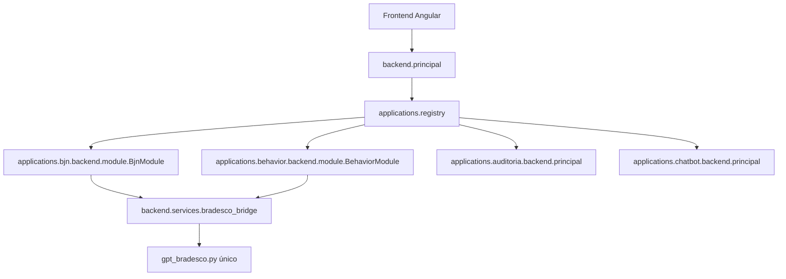

# Padronização dos módulos de backend — 16/11/2026

## 1. Objetivo

Organizar todos os produtos sob `applications/`, separando comportamento de
negócio da infraestrutura. A migração do BJN é estrutural: não altera o schema
SQLite, o contrato HTTP, o motor da IA ou qualquer regra jurídica/financeira.

## 2. Estrutura adotada

```text
ecossistema-juridico/
├── .env.example                 único exemplo de ambiente corporativo
├── gpt_bradesco.py              único módulo corporativo
├── backend/                     host ASGI; config, segurança, Bridge
│   ├── principal.py
│   ├── config.py
│   └── services/bradesco_bridge.py
└── applications/
    ├── registry.py              registro central de produtos
    ├── bjn/
    │   ├── backend/
    │   │   ├── module.py         ponto único de instalação
    │   │   ├── routers/         rotas HTTP
    │   │   └── services/        domínio e repositório
    │   ├── config/
    │   ├── prompts/
    │   ├── data/cadastros/
    │   └── evidence/
    ├── behavior/backend/        extensão da API host
    ├── auditoria/backend/       FastAPI montada isoladamente
    └── chatbot/backend/         FastAPI montada isoladamente
```

Os quatro produtos têm backend próprio. Dois estilos de execução são
intencionais: extensões (BJN/Behavior), para herdar a política de acesso do host;
subaplicações montadas (Auditoria/Chatbot), para preservar contratos e
configurações operacionais herdadas. Eles **não são processos isolados**.

## 3. Conexão



## 4. Tutorial para novo produto

1. Execute `python scripts/scaffold_application.py triagem --label "Triagem"`.
2. Organize seus contratos e recursos em `applications/triagem/backend`,
   `applications/triagem/prompts`, `config` e `data`.
3. Registre `TriagemModule` em `applications/registry.py`, dentro de
   `api_extensions`. Não é necessário modificar `backend/principal.py`.
4. Registre a rota em `frontend/src/app/app.routes.ts` e a entrada em
   `frontend/src/app/core/application-registry.ts`.
5. Faça testes de autorização, erro de entrada, ciclo de vida, respostas HTTP,
   auditoria e privacidade. Os exemplos e um passo a passo completo estão em
   `docs/COMO_ADICIONAR_APLICACOES.md`.

## 5. Passos para atualizar uma instalação anterior

1. Faça backup autorizado do `.env` e de `.runtime/`, que nunca devem ser
   copiados para um repositório ou ambiente não homologado.
2. Extraia o ZIP novo em uma pasta de código separada e reutilize o `.env`
   de forma segura, sem anexá-lo a tickets.
3. Ajuste imports Python legados que apontem para `backend.services.bjn_*`
   ou `backend.routers.bjn*`, utilizando `applications.bjn.backend.services`
   e `applications.bjn.backend.routers`.
4. Atualize caminhos de catálogos e prompts se existirem scripts externos.
   `BJN_DEPARTMENTS_CSV`, `BJN_AGENCIES_CSV` e `BJN_CLAUSE_CATALOG`
   continuam sendo aceitos para arquivos autorizados em locais externos.
5. Execute `python -m pytest -q tests`, depois `npm test`/`npm run build`
   no ambiente Angular. Verifique `/api/v3/saude`, `/api/v3/bjn/questionario`,
   `/api/v3/bjn/demandas/configuracao`, e as APIs montadas.
6. Homologue junto a Segurança, Jurídico/Compliance e DPO os controles
   necessários à sua implantação.

## 6. Decisões, riscos e limites

- **Não duplicar serviços BJN:** evita estados diferentes da mesma demanda
  e facilita uma única trilha de auditoria por produto.
- **Bridge e segredos centralizados:** evita credenciais em subdiretórios.
- **URLs antigas preservadas:** frontend existente continua consumindo
  `/api/v3/bjn/` e `/api/v3/ai-ready/` sem alteração.
- **BJN persistência privada:** `.runtime/bjn` não foi movida; não se mexe
  em informações processuais de uma instalação real.
- **Compatibilidade de import:** ferramentas Python internas com imports
  antigos precisam ser ajustadas.
- **Limite:** rotas e serviços legados do AI Ready permanecem no host por
  compatibilidade e poderão ser consolidados em trabalho separado.

## 7. Checklist de homologação

- [ ] Backend inteiro e testes de contratos em Python.
- [ ] Testes do frontend e build Angular com dependências corporativas.
- [ ] Login/gateway, perfis, permissão, trilha de auditoria e retenção.
- [ ] Integração real com `gpt_bradesco` no ambiente autorizado.
- [ ] Revisão de importações em automações externas e pastas de CSV.
- [ ] Aprovação formal dos times responsáveis.
